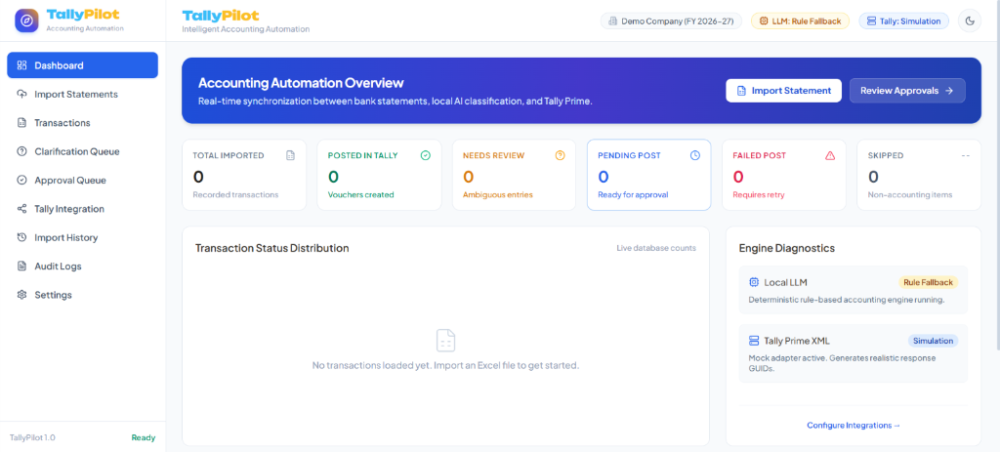

# 🌐 TallyPilot Frontend: Intelligent Accounting Automation UI


A responsive, high-performance web dashboard built for financial teams to ingest bank statements, resolve ambiguous transaction classifications, approve double-entry accounting vouchers, and monitor real-time synchronization with **Tally Prime**.

---

## 🖼️ Dashboard Preview

<div align="center">
  
</div>

---

## 🛠️ Tech Stack & Key Technologies

- **UI Library & Framework:** **React 18** with functional components, hooks, and **TypeScript** for strict compile-time type safety.
- **Build Tool & Bundler:** **Vite 5** providing sub-second Hot Module Replacement (HMR) and optimized Rollup chunk-splitting for production builds.
- **Styling & Design System:** **Tailwind CSS 3.4** paired with `clsx` and `tailwind-merge` for adaptive, utility-first UI styling.
- **Data Visualization:** **Recharts** delivering responsive, animated bar charts for transaction status distribution.
- **Icons & Visual Language:** **Lucide React** providing consistent, modern financial and system status iconography.
- **API Communication:** **Axios** client configured with environment-based proxy support (`/api` $\rightarrow$ `http://localhost:8000`), handling JSON payloads, file uploads, and CSV downloads.
- **Routing:** **React Router DOM v6** managing client-side navigation across operational views.

---

## 💎 Features

- **Executive Automation Dashboard:** Real-time KPI summary cards (*Total Imported*, *Posted in Tally*, *Needs Review*, *Pending Post*, *Failed Post*, *Skipped*) and status distribution bar chart.
- **Statement Ingestion Hub:** Drag-and-drop file uploader supporting `.xlsx`, `.xls`, and `.csv` bank statements with immediate import feedback and error reporting.
- **Transaction Explorer:** Filterable and paginated transaction grid with real-time status indicators, voucher typing, and debit/credit formatting.
- **Human Clarification Queue:** Dedicated triage interface for low-confidence or ambiguous entries (e.g., unfamiliar UPI transfers), allowing operators to search ledgers and apply corrections in one click.
- **Voucher Approval Queue:** Side-by-side double-entry review (*Primary Ledger* vs *Bank Ledger*) with single-click authorization or bulk batch approval before submitting to Tally Prime.
- **Tally Integration Center:** Live connection ping, ledger master synchronization, cached ledger table inspector, and durable voucher submission log viewer.
- **Audit Logs & CSV Export:** Chronological audit trail recording actor actions, timestamped transitions, and one-click CSV report export.
- **System Settings:** Runtime configuration management for Tally endpoints, company names, and classification confidence thresholds.
- **Adaptive Dark & Light Theme:** Context-driven theme switcher with persistent local storage and tailored color palettes.

---

## 📐 Component & Routing Architecture

```mermaid
flowchart TD
    App[App Container] --> ThemeProvider[ThemeContext Provider]
    ThemeProvider --> Router[React Router DOM]
    Router --> Layout[App Shell Layout]
    Layout --> Navbar[Top Navigation & Status Badges]
    Layout --> Sidebar[Sidebar Navigation & Live Counters]
    Layout --> Pages[Routed Page Views]
    
    Pages --> P1[DashboardPage]
    Pages --> P2[ImportPage]
    Pages --> P3[TransactionsPage]
    Pages --> P4[ClarificationQueuePage]
    Pages --> P5[ApprovalQueuePage]
    Pages --> P6[TallyPage]
    Pages --> P7[ImportHistoryPage]
    Pages --> P8[AuditLogsPage]
    Pages --> P9[SettingsPage]

    Pages --> ApiService[Axios API Client]
    ApiService --> Proxy[/api Proxy / Vite Server]
    Proxy --> FlaskBE[Flask Backend :8000]
```

---

## 🚀 Setup & Installation

### 1. Navigate to the Frontend Directory
```cmd
cd frontend
```

### 2. Install Node Dependencies
```cmd
npm install
```

### 3. Setup Environment Variables
Configure `.env` in the `frontend/` directory (or use default values):

```env
# Base API prefix for HTTP requests
VITE_API_BASE_URL=/api

# Proxy target forwarding /api calls to the backend server
VITE_API_PROXY_TARGET=http://localhost:8000
```

### 4. Start Development Server
```cmd
npm run dev
```
Open **`http://localhost:5173`** in your browser.

### 5. Production Build & Optimization
To build the application for production deployment:
```cmd
npm run build
```
This performs TypeScript type-checking and generates chunk-optimized assets in the `dist/` directory:
- `vendor`: React, React-DOM, React-Router
- `charts`: Recharts bundle
- `icons`: Lucide icon bundle
- `index`: Application core code and styles

### 6. Preview Production Build
```cmd
npm run preview
```

---

## 📁 Directory Structure

```text
frontend/
├── src/
│   ├── components/              # Shared layout components
│   │   ├── Navbar.tsx           # Header bar with branding, company pill & theme toggle
│   │   └── Sidebar.tsx          # Side navigation with live badge counts
│   ├── context/                 # React Context providers
│   │   └── ThemeContext.tsx     # Light/Dark mode state management
│   ├── pages/                   # Main operational page views
│   │   ├── DashboardPage.tsx    # KPI overview & status distribution chart
│   │   ├── ImportPage.tsx       # Bank statement file upload dropzone
│   │   ├── TransactionsPage.tsx # Master transaction list & pagination
│   │   ├── ClarificationQueuePage.tsx # Ambiguous entry resolution
│   │   ├── ApprovalQueuePage.tsx      # Voucher review & batch authorization
│   │   ├── TallyPage.tsx        # Tally Prime status, sync & submission logs
│   │   ├── ImportHistoryPage.tsx      # Statement batch history
│   │   ├── AuditLogsPage.tsx    # Chronological audit trail & CSV export
│   │   └── SettingsPage.tsx     # Application settings & engine diagnostics
│   ├── services/
│   │   └── api.ts               # Axios API client methods & endpoints
│   ├── types/
│   │   └── index.ts             # TypeScript interfaces & type definitions
│   ├── App.tsx                  # Application root & router configuration
│   ├── index.css                # Tailwind CSS direct imports & base theme styles
│   ├── main.tsx                 # DOM mount entrypoint
│   └── vite-env.d.ts            # Vite client environment typing declarations
├── dist/                        # Production build output directory
├── package.json                 # Node package configuration & scripts
├── postcss.config.js            # PostCSS configuration
├── tailwind.config.js           # Tailwind CSS theme configuration
├── tsconfig.json                # TypeScript compiler configuration
├── vite.config.ts               # Vite configuration with proxy and Rollup chunk splitting
├── .env                         # Development environment variables
├── .env.production              # Production environment variables
└── README.md                    # Frontend documentation
```

---

## 📝 License

Distributed under the MIT License. See `LICENSE` for more information.

